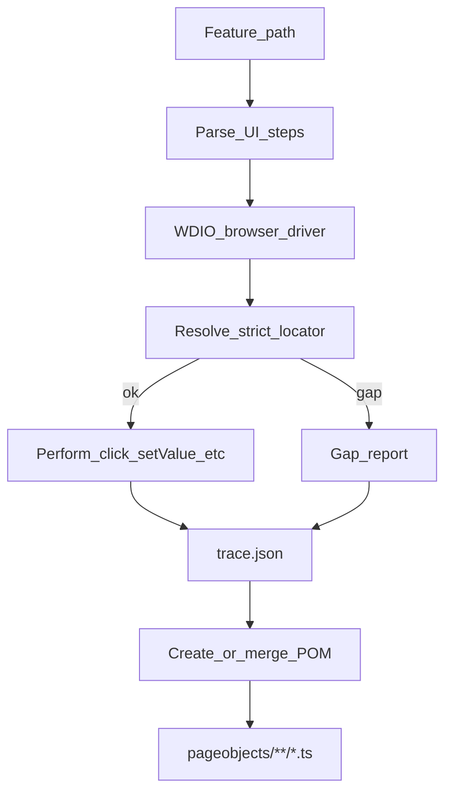

# Feature-to-WDIO Page Objects Copilot Skill

## Overview

Build a GitHub Copilot agent skill that drives a WebdriverIO browser from UI-language Cucumber features, records only configurable-attribute locators (with ancestor+child paths), and creates or merges locator-only TypeScript page objects.

## Goal

Ship a GitHub Copilot skill that, given a local feature path (contents stay private), **drives the browser itself** via WebdriverIO, resolves elements using a **configurable strict attribute**, and **creates or merges locator-only** page objects under `pageobjects/**/*.ts`.

## Locked requirements

- **Input:** Cucumber `.feature` files in UI language (`features/**/*.feature`)
- **Execution:** Skill-owned WDIO browser driver (not Cucumber step defs)
- **Step defs:** May exist under `step_definition/**/*.ts`; read-only hints only; do not generate/update in v1
- **Output:** Locators only (getters with `$()`), TypeScript page objects in `pageobjects/**/*.ts`
- **Strict locators:** Only `[<locatorAttribute>="…"]`, optionally plus a **relative child CSS** when the interacted node lacks the attribute but an ancestor has it
- **Update mode:** If a page object file is provided or matched, merge getters; preserve unused getters
- **No feature paste:** Skill accepts file paths only

## Repo layout (this repo becomes the skill package)

```text
.github/skills/feature-to-wdio-page-objects/
├── SKILL.md
├── config.example.json
├── examples/
│   └── login.page.ts
├── templates/
│   └── page.ts.hbs
└── scripts/
    ├── drive-feature.mjs      # parse feature + drive WDIO + write trace
    ├── resolve-locator.mjs    # attribute / ancestor+child resolution
    ├── merge-page-object.mjs  # create or merge getters into *.ts
    └── lib/
        ├── parse-gherkin.mjs
        ├── step-grammar.mjs
        ├── score-candidates.mjs
        └── ts-getters.mjs
```

Consumers install into a WDIO repo (or copy the skill) so scripts run next to that project's `wdio.conf.*`.

## Architecture



## Locator resolution (strict)

Config key: `locatorAttribute` (e.g. `test-automation-id`).

For the DOM node chosen for a step:

1. If node has the attribute → `$('[attr="value"]')`
2. Else nearest ancestor within `maxAncestorDepth` that has the attribute → `$('[attr="value"] <relativeCss>')` where `relativeCss` is the shortest stable path from ancestor to node (`input`, `input[type="text"]`, `> input`, etc.)
3. Else record gap; **never** emit `#id`, class-only, text, or free XPath roots

Relative path may use tag/type/name/`nth-of-type` only to disambiguate **within that ancestor**. Flag `fragileRelative: true` when nth-based.

### Example

```html
<div test-automation-id="login-username-field">
  <input type="text" />
</div>
```

Generated getter:

```ts
get loginUsernameFieldInput () {
  return $('[test-automation-id="login-username-field"] input')
}
```

## Browser driver behavior

- Launch via existing project WDIO config (`baseUrl`, caps, timeouts, auth)
- Parse Gherkin locally; map UI steps via a small grammar:
  - click / enter|type / select / clear / check / navigate / should see
- Candidate pool: only nodes under `[locatorAttribute]` subtrees
- Score by step target phrase vs attribute value, label, `aria-label`, visible text, role
- Unique best match → act + record; ambiguous → stop scenario; missing attribute → gap and continue (default)
- Prefer existing step-def files only as optional naming hints, not for execution

## Page object create/merge

- Auto-map by URL/route convention to `pageobjects/<name>.page.ts`, or use explicit path from user
- Emit WDIO getters only, matching `examples/login.page.ts` style (TypeScript, `@wdio/globals`, getter returns `$()`)
- Naming: camelCase from attribute value; append element tag when relative child is used (e.g. `loginUsernameField` + `Input`)
- Merge rules: add new getters; update selector if same name differs; **never delete** getters not seen in this run
- Do not generate action methods or step definitions in v1

## Skill instructions (`SKILL.md`)

Frontmatter: `name: feature-to-wdio-page-objects`, description with triggers (WDIO page objects, feature to POM, locators from feature, test-automation-id), `compatibility` noting Node + WDIO + network to app.

Body must instruct Copilot to:

1. Collect feature path, optional page object path, `locatorAttribute`, confirm WDIO project root
2. Run `scripts/drive-feature.mjs` (not ad-hoc clicking)
3. Run `scripts/merge-page-object.mjs` on the trace
4. Summarize created/updated getters + gaps without pasting feature file contents
5. Enforce strict attribute policy with ancestor+child only

## Default config (`config.example.json`)

```json
{
  "locatorAttribute": "test-automation-id",
  "strict": true,
  "allowAncestorAttribute": true,
  "maxAncestorDepth": 8,
  "featuresGlob": "features/**/*.feature",
  "stepDefinitionsGlob": "step_definition/**/*.ts",
  "pageObjectsDir": "pageobjects",
  "pageObjectsGlob": "pageobjects/**/*.ts",
  "generate": "locators-only",
  "onExistingPageObject": "merge",
  "preserveUnusedGetters": true,
  "onMissingAttribute": "record-gap-and-continue",
  "onAmbiguousMatch": "stop-scenario",
  "onActionError": "stop-scenario"
}
```

## Implementation order / todos

1. **IR + locator resolver** — pure functions: node → `{ attrValue, relativeCss?, fragileRelative }`
2. **UI step grammar + Gherkin parse** — steps → `{ action, target, value? }`
3. **WDIO drive script** — session, navigate, resolve, act, `trace.json` + `gaps.json`
4. **TS merge** — parse existing getters (regex/lightweight AST), render via template, write file
5. **`SKILL.md` + example + config.example** — wire Copilot workflow
6. **README** — install (`gh skill` / copy to `.github/skills`), required WDIO peer setup, example prompts

## Out of scope (v1)

- Generating or updating `step_definition/**/*.ts`
- Non-attribute fallback locators
- Deleting unused getters
- Shared component extraction
- Mobile/Appium selector packs

## Success criteria

- Running the skill against a feature path produces/merges TS page objects whose every locator is rooted at `[<configured-attr>="…"]`
- Parent-wrapped inputs get ancestor attribute + relative child path
- Missing attributes appear in a gap report without invented fragile roots
- Re-running with an existing page object file merges without wiping other getters
- Feature contents are never required in chat
